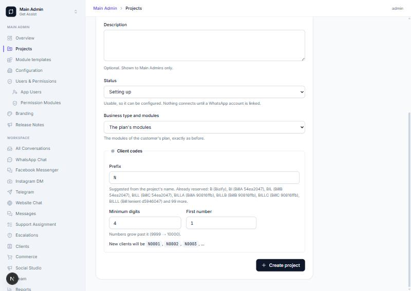
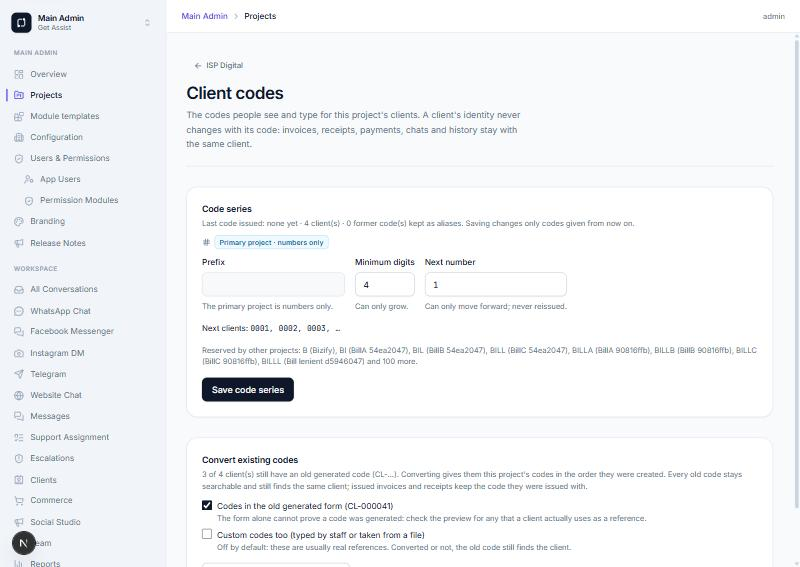
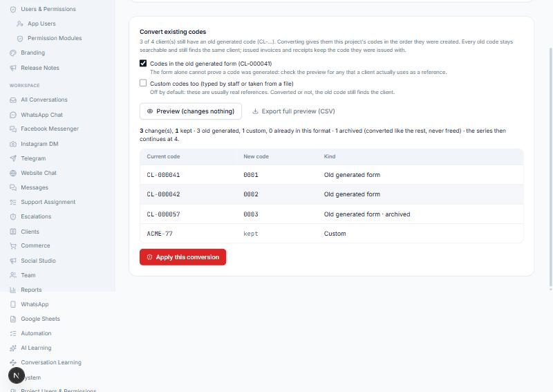
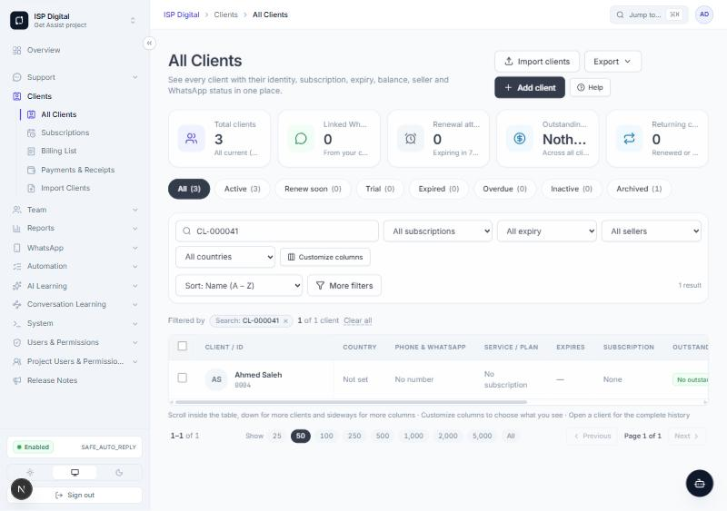
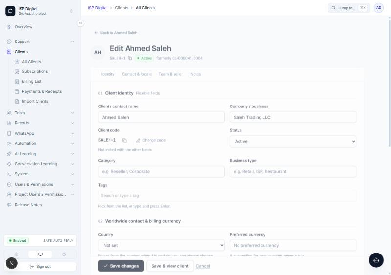
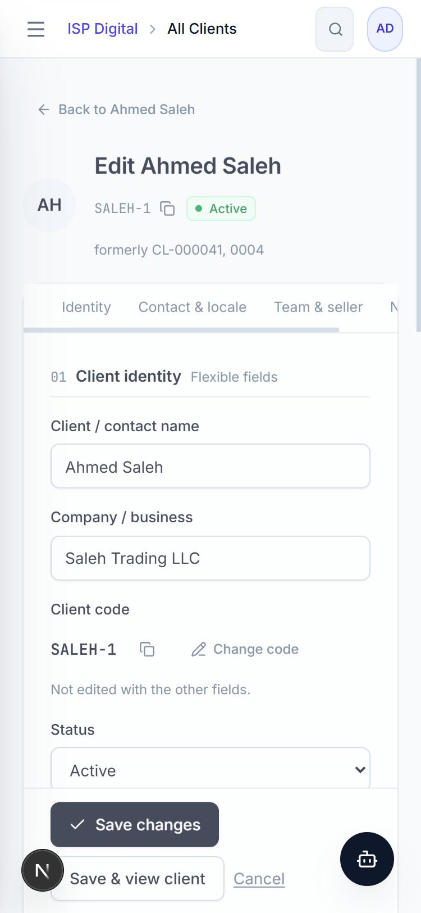

# Client CRM V6 — codebase map, what this PR does, what comes next

Spec: "GET ASSIST — CLIENT CRM, BILLING, RENEWAL & PROJECT CLIENT-CODE MASTER IMPLEMENTATION PROMPT (V6)".
Branch `feature/client-codes-v6`, from `main` at `569b3ac` (re-read on 31 Oct 2026; unchanged since the spec's
inspection). The spec asks for small, separately reviewable PRs. **This PR is WP0–WP3.** WP4–WP9 are later PRs,
planned below.

## WP0 — verified map (what the code actually does on main)

**Client codes before V6**
- `formatClientCode(n)` → `CL-` + 6 digits.
- `nextClientCode()` (web `server/clientRecords.ts`) → `nextval('client_code_seq')`: ONE sequence for the whole
  installation, across every customer and project.
- Only two places create clients:
  - `createClient` (`server/actions/clients.ts`);
  - `createImportedClient` (`server/clientImport.ts`), used by the classic import and by Smart Import's processor
    (`server/smartImportProcessor.ts`).
  Nothing in the worker creates clients.
- `Client.code` is a plain string, `@@unique([projectId, code])` (case-sensitive).
  - Anyone with `clients.create` / `clients.update` could type or change it freely.
  - The update only kept the old code when the field was left empty.
- An import's mapped code became the new client's code, and matched existing clients by code (case-insensitive).

**Projects**
- `createProjectWithDefaults` (packages/db) is the one way a project is made. Callers:
  - Main Admin's Create project (`server/actions/projects.ts`);
  - the platform's customer provisioning (`server/platform/actions/customers.ts`);
  - ~90 test fixtures.
- `Project.customerId` NULL = the original installation; the founding customer's own projects may also carry its id.

**Client 360° profile**
- `clients/[id]/page.tsx` held an inline `
` with `ClientForm mode="edit"`, opened by
  `?edit=1#edit-client`.
- The All Clients row menu (`ClientsTable.tsx`) linked there too.

**Billing / payments / renewal / messaging (WP4–WP8 inputs, unchanged by this PR)**
- `ClientDue` (Decimal(12,2)), `ClientPayment`, `ClientPaymentAllocation`; `INV-` / `RCPT-` numbers from their own
  sequences.
- Billing row menu: Open client, Delete invoice only.
- Payment rows: reverse / delete.
- `sendPersonalChatMessage` refuses a chat with no stored message: no first message, by design.
- The SMTP outbox (`EmailOutbox`) is built for connection tests.
- `SavedReply` and `NotificationTemplate` are separate concepts.

**Conflicts between the spec and the code, and how they were resolved**
- *"Search, imports and duplicate checks accept historical aliases"* vs the old import rule that a file's code becomes
  the client's code. The new default keeps the file's code as an alias and gives the project's code. Using the file's
  code is an explicit, privileged option (spec §2.4 (b)/(c)).
- *"Non-conflicting code namespaces across projects"* means a digits-only typed code (e.g. `000007`) is refused in a
  NON-primary project, because digits only are the primary project's form. In the primary project it is allowed. As
  an import reference it is always kept, as an alias.
- *"Manual code change privileged"*: no new permission key was added. The existing **Manage Client Module Settings**
  (`clients.manage_settings`) gates it, so no seed or role migration is needed.

## WP1–WP3 — in this PR

See `CLIENT_CODES.md` for every rule and the admin guide. In short:
- **Series per project.**
  - Primary = numbers only; other projects get reserved letter prefixes, with collision-safe suggestions.
  - Atomic allocation. Versioned prefix changes. Width only grows; the next number only moves forward.
- **Backfill.** The migration gives every existing project its series (each customer's oldest project is primary).
  No client's code changes.
- **Main Admin.**
  - Create project → *Client codes* panel with a live preview.
  - Project → *Client codes* page: settings, history, conversion preview, CSV export, and apply behind
    `CLIENT_CODE_CONVERSION_ENABLED` with the project name typed.
  - Recovery script: `scripts/revert-client-code-conversion.sql`.
- **Aliases.** Former codes and import references stay searchable and matchable; they are append-only.
- **Edit client.**
  - Dedicated `/clients/<id>/edit` page, reached from every Edit link; old `?edit=1` links redirect.
  - Section nav, unsaved-changes warning, Save / Save & view.
  - Code shown with Copy, plus a privileged, logged **Change code**.
- **Add client.** Shows the next code. Only the privileged may type one, and a typed code is checked against the
  project and every other project's form.

## Screenshots (local build on the throwaway database, 31 Oct 2026)

| | |
|---|---|
| Create project → Client codes: suggested prefix, reserved prefixes (capped list), next three codes |  |
| Project → Client codes: primary project (numbers only), next codes, settings |  |
| Conversion preview: old codes → 0001–0003 in creation order, archived included, custom kept |  |
| All Clients searched by the OLD code `CL-000041` finds the client, now `0004` |  |
| Edit client (desktop): section links, code with Copy and Change code, "formerly …", sticky save |  |
| Edit client (375 px): no page overflow, section links scroll |  |

Also checked by hand in that pass:
- A reserved prefix is refused live and again by the server.
- Applying the conversion wrote aliases with one batch id, moved the series and logged a WARN entry.
- The recovery script previewed, then reverted that batch exactly; re-applying it worked.
- An old `?edit=1` link redirects to the Edit page.
- Save & view returns to the profile.
- "Change code" refused `N0005` (another project's form) and accepted `SALEH-1`, keeping both former codes.
- Add client previewed `0007` and created `0007`.

## WP4–WP9 — planned PRs (not in this PR)

| WP | Scope | Key decisions to keep |
|---|---|---|
| WP4 | Invoice detail page `/clients/dues/<id>`, real row menu (View, Edit, Record payment, PDF/Print, History, Void), Invoice & Receipt setup (project branding), HTML + PDF documents | One ledger (`ClientDue`/`ClientPayment`/allocations); issued documents snapshot their content; no edit of a settled amount/currency |
| WP5 | Receipt view/print/PDF, payment list actions, allocation view | Receipt only for a recorded payment; reversal keeps history; still 2 decimals (3-decimal posting needs its own migration) |
| WP6 | Renewal workspace + `ClientRenewalOffer` lifecycle (draft → sent → negotiating → accepted/declined/expired → converted) | An offer is never a subscription, invoice or payment; converting is an explicit Renew, once (idempotency key) |
| WP7 | Client communication templates (variables allowlist, preview), manual open/copy, `wa.me` fallback | A local template is not a provider-approved one; an external click is never "sent" |
| WP8 | Verified sending: client email over SMTP outbox, official Meta channels within their windows, selected-recipient bulk with eligibility preview | Off by default; consent/opt-out; no bulk from the browser WhatsApp engine |
| WP9 | Regression, performance, screenshots, rollback rehearsal | — |
