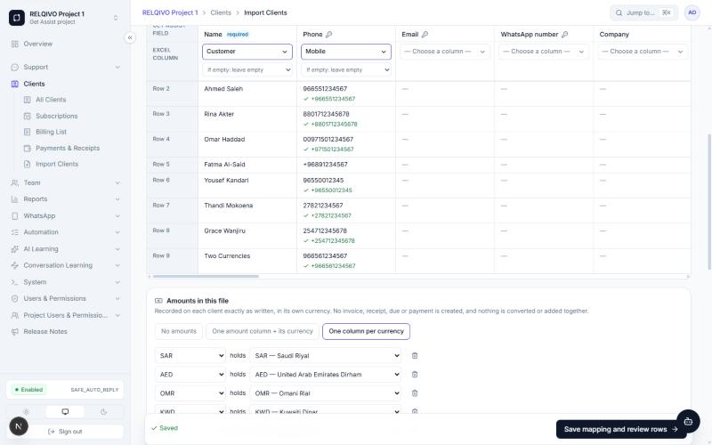
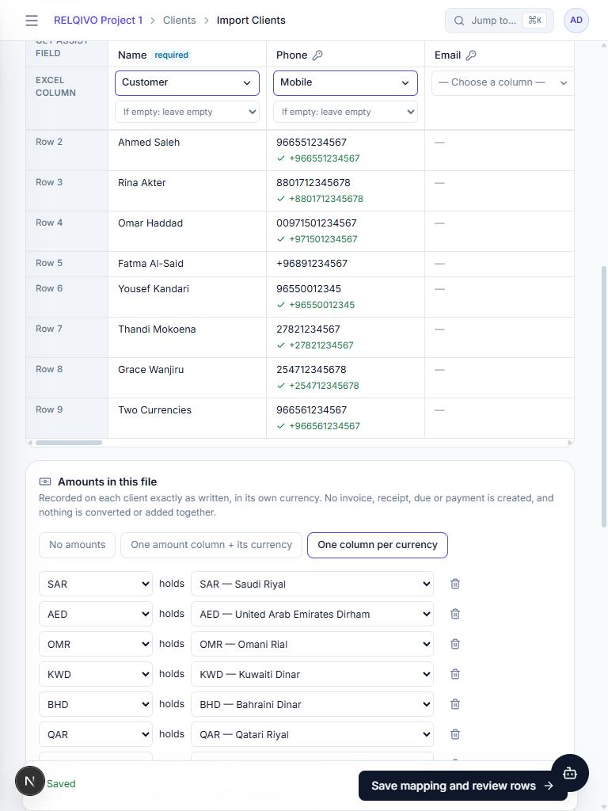
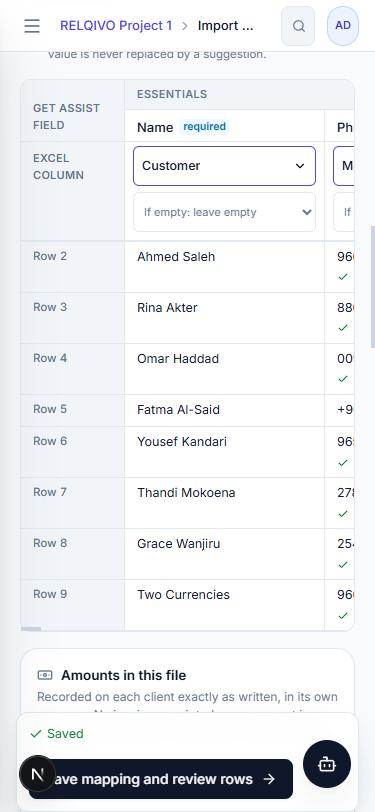
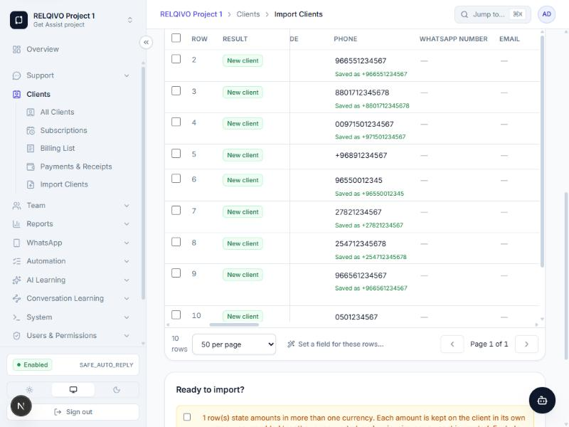

# Smart Import V5 + Visual Mapping + Client Configuration Center

Branch `feature/smart-import-v5` (from `rudra`), 31 Oct 2026. Not deployed. Rules live in
`SMART_IMPORT.md` §12 and `CLIENT_CONFIGURATION.md`; this page is the release write-up.

## Finding before anything was built

The request asked to keep "the original approved Visual Mapping design". It did not exist: not in this
repository on any branch or worktree, and not in the design folder supplied with the request. The mapping screen
was the vertical field list only. V5 builds the horizontal grid and makes it the permanent default; the vertical
list stays as "Detailed view".

## Screenshots (local test app, throwaway database, a 10-row file with a cover sheet)

| | |
|---|---|
| Mapping grid, desktop 1440 px — fields across the top, Excel column under each, real rows below with the stored E.164 under each number |  |
| Tablet 768 px — the grid scrolls inside its own box, the page does not widen |  |
| Mobile 375 px — field labels pinned, grid scrolls sideways |  |
| Review — each phone with "Saved as +…"; the row that needs fixing has none |  |

## What shipped

1. **Visual Mapping grid** as the first mapping screen, with live previews from the import's own staged rows.
2. **Sheet choice**: the best-looking sheet opens (root cause of "0 rows" was always opening the first sheet).
3. **Phones** normalised to E.164 with libphonenumber-js, never guessed; old stored numbers still match.
4. **Country / currency / language** from the file, the person, or a valid phone, labelled by source; a derived
   value only fills an empty field.
5. **All ISO 4217 currencies**, favourites, no 30-currency cap, no conversion.
6. **Amounts in several currencies** read exactly and **recorded only** on the client (`Client.importedAmounts`) —
   no invoice, receipt, due, payment or balance.
7. **Kept columns** as custom fields; **Business type** as an import and form field.
8. **Client Configuration Center** (Settings → Client Lists): tags, categories, business types, services & plans,
   currencies, countries, languages; audited; renames propagate; nothing is ever taken from a client.
9. **Add / Edit Client** uses the lists, suggests locale from the phone, takes several languages, offers plan
   defaults and an exact expiry date.
10. **Money precision**: amounts are stored exactly or refused — string arithmetic, no floating point, no rounding.
11. Fixed on the way: a hydration error on Add Client (country names differ between Node's and the browser's ICU);
    the mapping save dropping the "fill from phone" switch.

## How it was verified

- Unit tests (shared, web) and integration tests on the throwaway Postgres (`test:isolated`), including break-tests
  that remove `legacyMatchKey`, `derivedSkip` and the shared save path and watch the tests fail.
- A browser pass on the local test app: upload, auto sheet choice, grid at three widths, previews, 11 currency
  columns detected, the review's provenance, the Configuration Center (adding a tag), Add Client auto-filling
  Saudi Arabia / SAR / Arabic from +966.
- **Not verified:** a deployed environment, real customer files beyond the constructed one, very large files with
  the new previews (the server work per mapping load measured ~200 ms on the test file).

## Known limits (honest)

- **Three-decimal currencies cannot be posted with a real third decimal.** Invoices, dues and payments are stored
  as `Decimal(12,2)` / minor units of 100. Widening them touches the ledger triggers, allocations and every
  report, so it was not done in this release. `KWD 2.550` posts as 2.55 exactly; `KWD 2.555` is refused with the
  reason, never rounded. Imported amounts are text and keep every digit.
- A "Plan" header is still suggested as **Category** (the legacy synonym). Mapping it to Service makes every row a
  subscription that needs a start date, so the suggestion was not changed silently.
- The project's default country is read when the import RUNS, not frozen when the mapping is saved.
- Previews show the first 8 staged rows; the review shows every row.
- The sheet score is a heuristic; "Change sheet or header row" overrides it.

## Deploy (when approved)

```
docker compose build app worker migrate
docker compose run --rm migrate      # 20261031090000_client_configuration, 20261031100000_client_imported_amounts
docker compose up -d --no-deps --force-recreate app worker
```

Both migrations are additive (new tables with project triggers, new columns with defaults). Rollback = the
previous image; the old code never reads the new columns.
